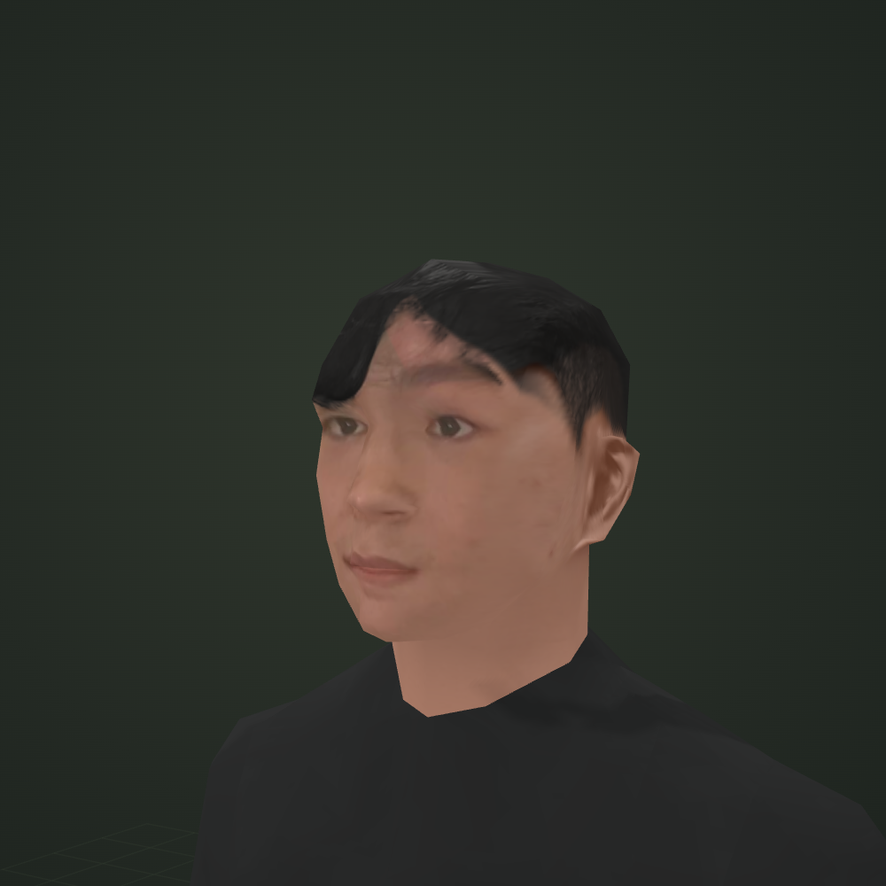

# GTA SA Character

Trình xem nhân vật 3D theo phong cách GTA San Andreas, với gương mặt, tai và tóc chỉnh theo ảnh tham chiếu.

**Mở site:** https://zenasharp.github.io/gtasa-character/

Kéo để xoay, cuộn để zoom. Chọn các góc xem cận mặt, hai bên đầu và gáy; thử tư thế hoặc tải model bằng nút **Tải model .GLB**.

[Tải model GLB](character-gtasa-base.glb) · [So sánh tai và tóc trước/sau](ear-hair-before-after.jpg)

Site tĩnh, không cần build. GitHub Pages phục vụ nhánh `main`, thư mục gốc. `index.html` nhúng model, Three.js và font để cũng có thể mở trực tiếp offline.

Model có 1.106 tam giác, 32 khớp; giữ thân và rig từ skin GTA SA `somyst`. File GLB không phải bộ DFF/TXD cài trực tiếp vào game.

## Nguồn và ghi công

- Game asset gốc: **GTA San Andreas / Rockstar Games**.
- Model nền được liên kết trong [CustomSeif/GTASA3DSkins](https://github.com/CustomSeif/GTASA3DSkins), bởi Mohamed Seif Khalid (CustomSeif).
- Model tham chiếu: [somyst.glb](https://res.cloudinary.com/custom/raw/upload/v1541335294/Skins/Models/somyst.glb).
- Bản này là chỉnh sửa asset gốc; không tuyên bố sở hữu model game gốc.
- Three.js: MIT. Font Barlow Condensed và Be Vietnam Pro: OFL. Xem thư mục [licenses](licenses/).
